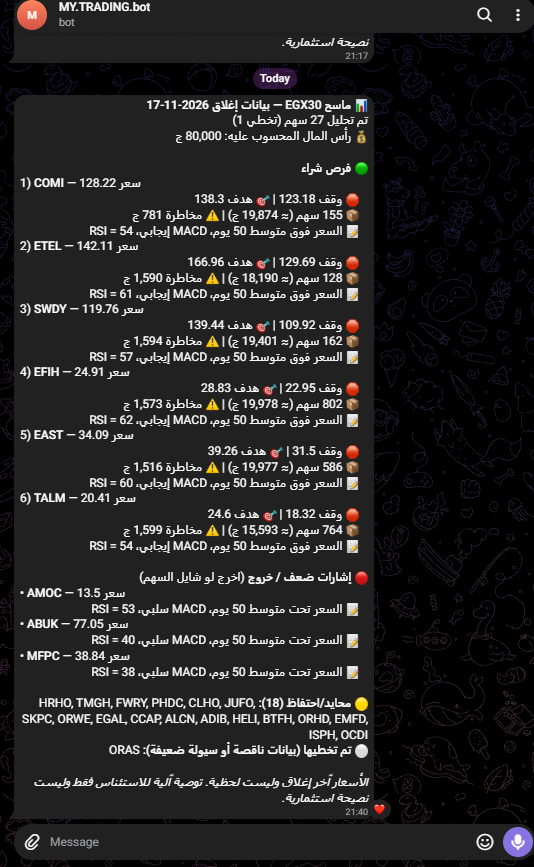

# EGX Swing-Trading Scanner & Backtester

A personal learning project: a daily scanner for 28 Egyptian Exchange (EGX) stocks that sends buy/exit signals to Telegram, plus a backtester that tests the same rules on historical data.

> **Not financial advice.** This is an educational project. The backtest results below are mixed, and the strategy did not beat buy-and-hold.



## What it does

- **Scanner** (`scanner.py`): after market close, downloads daily prices via `yfinance`, computes indicators, and sends a ranked list of buy candidates with an ATR-based stop-loss, a 2:1 reward/risk target, and a position size (2% risk per trade, 25% max per stock).
- **Strategy** (`strategy.py`): SMA20/SMA50 trend, MACD histogram, RSI, ATR. The *same functions* are used by both scanner and backtester, so backtest results describe what the scanner actually does.
- **Backtester** (`backtest.py`): event-driven simulation with no look-ahead. Signals come from the day's close and fills happen at the next day's open. It includes 0.25% fees per side, gap handling, and conservative fills (if stop and target are both touched on one day, the stop is assumed to hit first). Max 5 open positions.
- **News note** (`news.py`): fetches recent Arabic headlines from Google News RSS and asks an LLM (Groq) to label them as supportive / negative / neutral. The LLM only summarizes. All trade decisions are rule-based.
- **Automation**: designed to run on a scheduled GitHub Actions workflow, with state (capital, holdings) stored in Supabase and commands handled via Telegram. Actions are disabled in this public repo; I run it from a private copy.

## Backtest results (2022-01 to 2026-11, 28 stocks, EGP 50,000 start)

| Metric | Result |
|---|---|
| Total return (nominal EGP) | +138.2% (about 19.8% per year) |
| Max drawdown | -34.7% |
| Trades | 473 (40% winners) |
| Avg win / avg loss | +12.4% / -6.6% |
| Profit factor | 1.19 |
| Equal-weight buy-and-hold of the same stocks | +400.7% |

**Conclusion:** the rule set is not robust enough to trade with real capital. It underperformed buy-and-hold.

## Known limitations

- **Survivorship bias:** the stock list was chosen with hindsight.
- **No out-of-sample test:** no walk-forward validation, and parameters are fixed.
- **Nominal returns:** EGP inflation and devaluation over this period inflate all figures, including buy-and-hold.
- **Scanner vs backtester:** the scanner sizes each signal independently and does not cap total open positions at 5 like the backtester does.
- **Data quality:** Yahoo Finance data for EGX can be incomplete (some tickers are skipped).

## Run locally

```bash
pip install -r requirements.txt
python backtest.py          # no API keys needed
cp .env.example .env        # fill in keys for the scanner
python scanner.py --dry     # print results without sending
```

Supabase is optional for local runs. See `supabase_schema.sql` for the tables.

## Next steps

- Walk-forward / out-of-sample validation
- Fix position-cap mismatch between scanner and backtester
- Replace hand-written rules with an ML classifier and compare against this baseline

## Stack

Python, pandas, yfinance, Supabase, Telegram Bot API, Groq API, GitHub Actions
